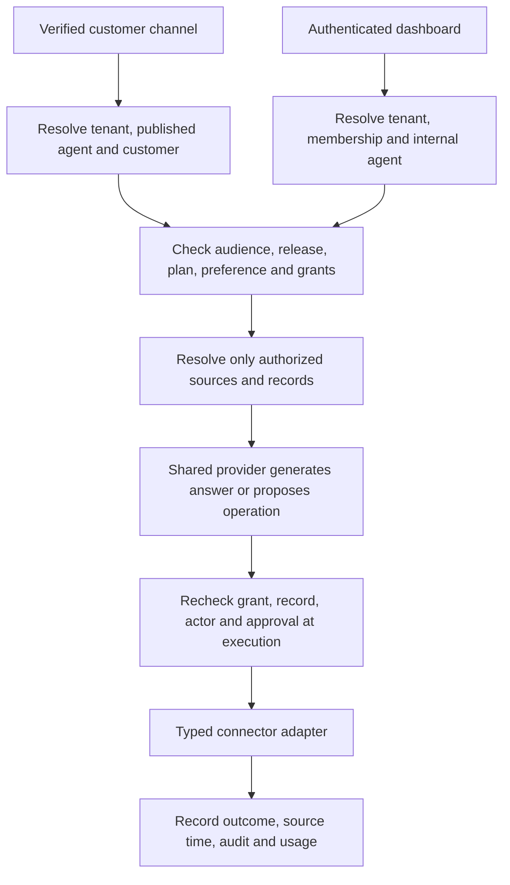

# Execution boundaries

Better Auth supplies the subject. withTenant resolves active membership and operation permission in a transaction with PostgreSQL RLS context. See database.md for schema and migration details. The studio additionally requires an Owner or Assistant manager role. Agent IDs, versions and thread IDs supplied by the browser are resolved under that context.

The model endpoint and model allowlist are server-controlled. System constraints take precedence over configuration. Versioned assigned sources and conversation text enter the model as untrusted user data. The only model-requested action supported is flagging the current conversation for staff if explicitly enabled. Staff must undertake any real-world action. Credentials stay server-side. Model failure and staff requests are audited; successful replies record usage. A model request currently holds a short-lived transaction with a 15-second OpenAI timeout or a 90-second local Ollama timeout. Production work includes durable request deduplication, quotas, recovery and spend controls.

The assistant studio and staff handoff queue use the same Owner or Assistant manager check on each request inside the tenant transaction. Assignment actions validate the conversation within the workspace and derive the claimant from authenticated membership. The existing unique index allows one active assignment per conversation. Releasing targets a specific assignment so a stale form cannot release a replacement. An owner can release an assignment left by an unavailable or revoked member. Changes are audited in the same transaction.

The dashboard optionally reads the selected workspace's assistant directory inside readWorkspace's tenant transaction. Only an Owner or Assistant manager receives the assistant list. The normal workspace API does not request it. Dashboard links carry workspace and assistant identifiers; studio authorization is checked again at the destination.

In-app staff actions recheck the manager role and lock both the paused conversation and the actor’s active assignment. The server records the authenticated membership on outbound staff messages, logs the action in the same transaction, and binds a reply identifier to each rendered form for retries. Resolution ends the assignment and closes the conversation atomically. The normal assistant send path rejects closed threads.

Workspace text facts are append-only revisions in the existing tenant-scoped knowledge_documents table. Both library management and assignment require an active Owner or Assistant manager. Saving a draft resolves shared document IDs from the current business and reconstructs title, body and revision server-side. Multiple revisions of a single fact cannot be attached to one version. The agent_knowledge relation reflects the latest draft; execution and historical retrieval inspection continue to use immutable version settings. Both fact creation and revision changes are audited.

Migration 0009 adds a retirement cutoff to the first revision of each library fact. Retiring a fact advances the cutoff and appends an audited revision in one tenant transaction. Saving or publishing checks the selected revisions against that cutoff and locks the matching fact roots through commit. Restoration appends a newly reviewed revision. Earlier revisions remain ineligible for new releases, and existing published configurations retain their snapshots.

The assistant editor's local model check reauthorizes the active workspace Owner or Assistant manager on the server. It queries only the fixed loopback Ollama tags endpoint, rejects redirects, and returns only the selected approved model's installation status. Credentials, conversation messages and the host's full model inventory stay out of the response. The check runs after the authorization transaction closes and uses an uncached request with a four-second timeout.

## Shared execution and Business Connect (approved design)

One Next.js application resolves identity and permissions. One workspace connection represents one external account or source. Adapters implement narrow, typed operations over that connection. The shared engine receives only permitted records, a bounded conversation history and the minimum configuration needed for the task. Never put a credential, unrestricted SQL capability or user-selected executable endpoint into model context.

| Boundary | Customer workforce | Business Copilot |
|---|---|---|
| Entry and identity | Verify channel signature/session, map channel account to a workspace and active published employee on the server. Verify customer identity separately for private records. | Require Better Auth session, active workspace membership and a specific operation permission. Resolve the internal employee for that workspace. |
| Knowledge and tools | Only customer-safe sources assigned to this employee. Own-order access requires verified ownership. No internal reports. | Only assigned sources and operations also available to the signed-in employee. Private sessions are restricted to authorized participants. |
| History and oversight | Keep channel, customer and agent version bound to the conversation. Pause automation on staff takeover. | Keep internal sessions distinct from channel transcripts, customer handoff exports and public analytics. Never route staff prompts into a customer conversation. |

Current studio tests and in-app published conversations are authenticated manager workflows. A name typed into that studio is not proof of a customer's identity. Public channel ingress and private Copilot entry points are planned.

### Permission matrix

| Actor | Connect or grant | Read | Execute changes |
|---|---|---|---|
| Owner or delegated connection admin | Authorize account, review scopes, rotate/revoke, assign subsets. Delegation cannot exceed actor rights. | Connection health and records permitted by business policy. | Only individually granted operations; sensitive acts require policy approval. |
| Staff | Explicit connection-management permission required. Current Assistant managers may curate manual knowledge. | Only own role and record scopes. Example: reception may access bookings. | Individual workflow permission; no inferred finance or personnel access. |
| Customer AI | None | Intersection of provider grant, agent assignment, customer-safe fields, verified customer scope and request. | Allowlisted business action with validated input, confirmation and idempotency where applicable. |
| Business Copilot | May propose configuration for authorized review | Same intersection plus the authenticated staff member's permissions. | Server rechecks actor, record version and current grant before acting. No platform-owner actions. |

For all four layers (connection, employee, actor and individual request), absence of a required grant denies access. Read, lookup, propose, approve and execute are separate operations. Store approvals against tenant, actor, exact normalized operation, amount or record, expiry and one-time request ID. Changing parameters invalidates approval. Enforce release gates for pages, server actions, scheduled syncs, retries, callbacks, channel ingress and tool execution.

### Proposed data and API changes

| Entity or entry point | Scope and behavior |
|---|---|
| Workspace connection | Tenant ID plus stable connection ID, adapter, vendor account identifier, state, encrypted credential reference, granted scopes and authorization generation. Separate provider-model connections can serve multiple agents; resolve platform-funded or workspace-funded billing identity server-side. |
| Connection source and sync run | Stable remote ID, provenance URL or record key, classification, mapping version, allowed fields, observed time, expiry, review state and tombstone. Track last attempt separately from last success, cursor, failed records and retry budget. Deduplicate webhooks per connection; reconcile missed and out-of-order events before moving a cursor. |
| Agent source/tool grants | Tenant-composite keys, connection, employee, audience, operation, record/field scope, approval class and live grant generation. Publish a configuration referencing IDs. Recheck live access before fetching, using cached records, supplying history, dispatching jobs or returning results. |
| Request, thread and usage | Persist audience, actor or verified customer, channel, selected agent/version and authorized participants. Bind provider request ID, workspace, agent, payer and usage to one execution. Track retries, actual provider units, estimated cost and settled charges separately. Redact inputs in traces. |
| API | Separate signed channel ingress and private Copilot session routes. Workspace-scoped connection management supports discovery, test, selected import, grant, refresh, rotation and revoke. Authenticate OAuth callback state against tenant, actor and expiry. Map credentials to the approved adapter host. Provide no general SQL or arbitrary proxy endpoint. |

**Revocation is a runtime operation.** Retiring a manual editorial fact currently preserves published snapshots. A future connector permission change must invalidate live access across dependent employees, caches, embeddings, queued work and model history. Mark affected sessions for fresh authorized context; previously sent answers cannot be recalled. Abort or withhold in-flight results if authorization changed. Recheck immediately before external writes and reconcile an action already accepted by the provider. Keep authorized audit evidence under retention policy. Never treat retiring a fact or saving a new draft as a connector access control.

### Retrieval, freshness and operations

- A website owner selects public pages after sitemap discovery, sets exclusions, reviews changes and schedules refreshes. Validate domains and resolved destinations on every fetch and redirect, exclude private networks and credentials, honor crawler policies, cap document sizes and isolate parsing. Treat text, documents and tool output as untrusted data.
- For laptop recommendations query normalized catalogue attributes, currency and price ceiling, then check availability using the permitted inventory operation. Show links and observation times. Stale price, unavailable inventory or an ambiguous currency must prompt qualification or a stated verification gap.
- For an oak table enquiry, read its product record, current stock and applicable delivery policy. Delivery to a specific address may require more input. An owner's restock/delay question uses scoped order and inventory aggregates. Neither request needs all customer records. Cached website stock cannot substantiate a live availability claim.
- Store credentials outside both model payloads and ordinary logs. Rotate with a connection health test, revoke provider tokens when possible, invalidate access on disconnect, and honor agreed retention/deletion policies. Meter concurrency, crawl pages, bytes, sync cadence and live API calls per workspace. Back off on throttling; queue bounded retries, record permanent failures and offer safe replay.

### Release acceptance

| Scenario | Required observable outcome | Current evidence |
|---|---|---|
| Two agents share one source in workspace A; workspace B requests it | Both see their assigned revisions. B is denied. | Local browser test with real database and simulated replies covers manual FAQ reuse, divergent revisions, and an outside account. Workspace and DB suites check tenant ID substitution. External connections pending. |
| Customer sends a message to a configured number or website | Only its active published employee runs; duplicates create one turn. An unpublished or disabled agent cannot serve it. | In-app published version and disable checks exist. Signed real channel ingress pending. |
| Customer, unauthorized employee or foreign workspace requests Copilot/report | Denied before retrieval, including direct endpoint calls. An authorized owner receives only scoped records. | Existing manager-only studio and role revocation exercised. Copilot-specific route, record policies and tests pending. |
| Remove one grant, then revoke the shared connection | First agent loses access while another authorized one continues. Revocation then blocks both including retries, stale sessions and cached snippets. | Pending connector infrastructure. Test with in-flight reads, queued writes and previous conversation context. |
| A retrieved document requests elevated access or a refund | Text remains untrusted. No grant changes. A sensitive action requires exact server approval, and replay produces at most one effect. | Provider payload boundary and rejection of unexpected output tested. External actions and approval replay pending. |
| Agent invokes a model on either surface | No raw provider credential enters model context, UI or audit. Usage is recorded once with correct workspace, agent, experience and payer. | Existing adapter tests cover server-only credentials and returned tokens; messages link to tenant, thread and agent. Cross-experience billing attribution pending. |
| Staff opens Business Connect on desktop and mobile | Correct workspace and source revisions; separate enabled releases and newer configurations; Viewer cannot navigate or read the library. | Shared-knowledge and team browser journeys. Live connector health, mobile approvals and Copilot pending. |

## Catalogue access in the in-app workforce

An Owner imports a bounded tab-separated snapshot of SKU, product name and description. Validation rejects the entire batch for invalid rows or duplicate SKUs. One tenant-owned knowledge document stores the structured items and import timestamp. Default access is empty. Composite tenant foreign keys in agent_knowledge bind each explicit grant to an assistant in the same workspace. The catalogue has no library revision key, so catalogue text cannot be adopted into a draft through the manual shared-fact assignment path.

For each message, the server locks the assistant, checks its active grants and selects at most four matching items from connected imports. Catalogue results include their source name and import time and enter only the untrusted user-data portion of the model request. They provide historical product descriptions. Live stock, pricing and delivery require separate tools.

Each grant change increments the assistant's access generation in the same transaction as the grant and audit change. Messages are stamped at write time. Subsequent model calls include only prior messages from the current generation; the owner can still inspect the stored transcript. This conservatively starts model context afresh across all threads for the affected assistant. Disconnect invalidates every affected assistant atomically. Source revision checks reject stale management forms. The current agent lock serializes provider turns and grant changes, so a revoke may wait for an already running turn. Future async workers must recheck authorization before releasing a result. Content already delivered to a person cannot be recalled.

Catalogue refresh uses the source revision as an optimistic concurrency check. The workspace Owner reviews a complete replacement keyed by case-insensitive SKU. Reordering identical products produces no change. One transaction locks the source, saves its prior structured items and import timestamp in catalogue_refreshes, updates the source, records the author and change counts, and advances the access generation for every assigned assistant. Grants remain attached to the same source ID. Workers and model requests only read the current snapshot. Historical snapshots are available through an Owner-only review route scoped to both workspace and source. The table has forced row-level security and composite foreign keys to the source and actor membership.
